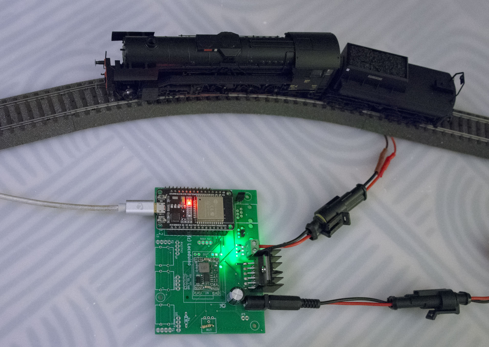
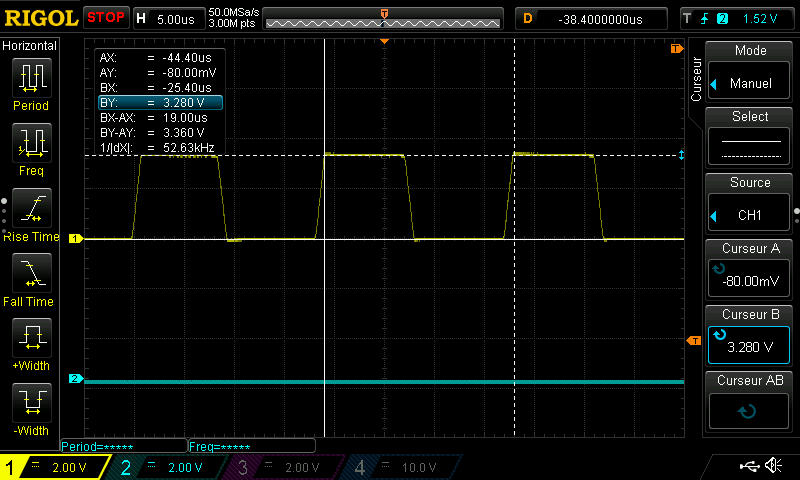
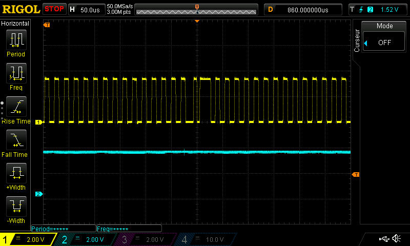
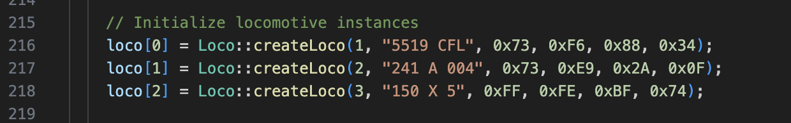

# MFX Track Station

*[Version française](README.md)*

DIY mfx®-compatible digital command station on an ESP32, to drive Märklin locomotives in the mfx format without a Gleisbox or a Central Station. The track signal is generated by the RMT peripheral of the ESP32.

*Formerly directMFX_ESP32: the old links redirect here.*

This project has a thread on the 3R forum (in French): https://forum.3rails.fr/t/controler-vos-trains-mfx-depuis-un-arduino-due-sans-passer-par-la-gleisbox/27563

> /!\ Work in progress, but functional: mfx locomotives can be driven from Rocrail.

### What works today

- **mfx signal** generated by the RMT of the ESP32: speed (127 steps), direction and functions F0 to F15.
- **Control from Rocrail** over WiFi, with the CS2 protocol (TCP port 15731). Rocrail can disconnect and reconnect without restarting the command station.
- **Several locomotives** (up to 16), declared in `src/main.cpp` with their mfx UID, or found automatically.
- **Feedback from the decoders** (see below): automatic discovery of new locomotives, check of their presence, reading of the CVs and of the configuration stored in the decoder (name, manufacturer, function symbols, acceleration, braking, minimum and maximum speed).
- **Short-circuit protection**: the track is switched off above the threshold (1 A by default) and only comes back on a Go from Rocrail.
- **FreeRTOS**: each function (signal, reception, current monitoring) runs in its own task.

### Still to do

- Automatic creation in Rocrail of the locomotives found on the track: the command station can answer the "loks" request like a CS2, but the `mbus` driver of Rocrail does not send it yet. Meanwhile, a discovered locomotive is declared by hand in Rocrail.
- Writing of CVs.
- Functions F16 and above, emergency stop, answers to Rocrail (state, overload).
- Move to the new RMT driver of ESP-IDF 5.
- Printed circuit board for the feedback sensor.

### Hardware

- **ESP32**: main microcontroller, handles the communications and the control.
- **H-bridge** (for example an L293D or equivalent): drives the power to the rails.
- **Power supply**: suited to the voltage of Märklin tracks (about 18 V).

The Box from Locoduino fits perfectly and gives a complete and proven hardware base (in French): https://forum.locoduino.org/index.php?topic=1618.msg20062#msg20062



Watch on YouTube: https://youtu.be/kIXx-TSOVpQ?si=jwideeNshVRPlX4l

### Feedback

A sensor on one track wire lets the decoders answer the command station. It is used for the **automatic discovery**: every 2 s, the command station searches for the mfx decoders that are not registered yet, reads their UID bit by bit, gives them a free address, then reads their configuration. The serial monitor prints the UID, the name read in the decoder and the line to add to `src/main.cpp`.

The sensor (schematic below):

- **T1**: Micrometals T50-26B iron powder toroid. The track wire OUT1 goes through it once (only one of the two wires). Secondary: 52 turns of 0.20 mm solderable enamelled wire (L ≈ 118 µH).
- **Tuned circuit** at about 53 kHz, the carrier of the answer of the decoders: 68 nF + 6.8 nF (polypropylene) and 150 Ω in parallel with the secondary. Its low end is at VREF = 1.65 V (10 kΩ / 10 kΩ divider decoupled by 1 µF).
- **Comparator** MCP6541 (DIP-8, 3.3 V) with a hysteresis of about ±50 mV (10 kΩ and 330 kΩ). Its output goes to **GPIO 26** (`FEEDBACK_PIN` in `src/main.cpp`).

The +3.3 V and the ground are those of the ESP32; the toroid isolates the sensor from the track.

[](/BOBILLEChristophe/MFX-Track-Station/blob/main/include/capteur_retour.png)

**1-bit feedback** (`Feedback::ask()`): after a command that expects an answer (search, verify), the command station holds the track at a constant level during two windows of 6.4 ms. A decoder answers "yes" in the first one by drawing a current at 52.6 kHz; the second one is a reference for the noise. In each window, the ESP32 counts the intervals of one carrier period (17 to 21 µs) between two rising edges of the comparator (`src/Feedback.cpp`): an answer gives about 300 of them, the noise of a motor almost none, as its edges come at random intervals. The command station takes it as an answer above 150, with at least 120 more than in the reference window.

**Reading of CVs** (`Feedback::readCV()`): the command station sends the read command (`111 000`, CV number, index, number of bytes: 1, 2, 4 or 8), then a long pause marked by short pulses (23 every 912 µs, then every 456 µs). The decoder answers during the whole pause by inverting the phase of its carrier: one inversion every 912 µs period, and one more in the middle for a 0 bit. The ESP32 timestamps each edge of the comparator; `lib/MfxDemod` finds the phase inversions, the bits, the bytes, and checks the checksum. The format was recorded on a Märklin Gleisbox and the unit tests decode these real answers. When the track is first powered, the command station reads the configuration of each declared locomotive (`lib/MfxConfig`, like the MS2: block table, name, manufacturer, symbols of functions F0 to F15, acceleration, braking, Vmin, Vmax, tachometer speed) and prints it on the serial monitor; it also does so for each new decoder found. Depending on the decoder, 40 to 60 reads, about fifteen seconds per locomotive: the command station waits 150 ms between two reads, as answering heats the decoder. The configuration is only read while the locomotive stands still (the noise of the motor would disturb the reading); a running locomotive is read later.

Answer of the Serie 150X to a read of a CV, seen on an oscilloscope (Rigol DS1000Z). In yellow, the output of the comparator (GPIO 26): the carrier of the decoder, squared. In blue, GPIO 25 (`Feedback::setScope()`): high while the ESP32 records the edges.



At 5 µs/div, measured with the cursors: the carrier has a period of 19.00 µs, that is 52.63 kHz, and swings from 0 to 3.3 V at the output of the comparator.



At 50 µs/div: the frequency does not change, the information is in the phase changes. In the middle of the screen, a longer pulse shifts everything after it by half a period: this is a phase change. The decoder makes one at each bit boundary (every 912 µs), and one more in the middle of a 0 bit.

**Decoders tested**:

| Locomotive | Decoder | Search and verify | Reading of CVs |
|---|---|---|---|
| Serie 150X | ESU, first generation (product `0200000E`) | yes | yes: 60 reads without error, including with another loco running on the track |
| 150 Y 17 | Märklin (product `0004068B`) | yes | yes |
| 040 DE 9 | recent ESU | no | no: it can be driven, but never answers on the track |

**Serial monitor commands** (one letter, then Enter):

- `R`: re-registration of every decoder. The re-registration counter is increased (and kept in memory), then the command station restarts; then press Go in Rocrail.
- `V`: verify each declared locomotive ("decoder at address 5, is your UID FFFEBF74?"), with the count of regular intervals in each window.
- `?`: help.

**Traces and oscilloscope** (`src/main.cpp`): `Feedback::setTrace(cv, search)` prints one line per read of a CV and/or per 1-bit request of the discovery. `Feedback::setScope(GPIO_NUM_25, mode, address)` sets GPIO 25 high during the windows of the 1-bit feedback (`ONE_BIT`), during the answer to a read of a CV (`DATA`), or both (`BOTH`), to trigger an oscilloscope; `SCOPE_OFF` leaves the pin free.

**Loco list for Rocrail** (`lib/Cs2Config`): like a CS2, the command station answers the "loks" request of Rocrail (command 0x20) with the file `lokomotive.cs2` (command 0x21): name, address, mfx UID and, when the configuration was read in the decoder, acceleration, braking, Vmin, Vmax, tachometer and type of each function. The format of the stream (size, zlib data, CCITT CRC) is the one of `can2lan` from the railroad project of Gerhard Bertelsmann. The command station also answers the ping of Rocrail like a CS2.

### Building

The project builds with PlatformIO. The platform is pinned (`espressif32@6.9.0`, Arduino core 2.0.17) in `platformio.ini`.

### WiFi setup

Copy `src/secrets.h.example` to `src/secrets.h`, then put the name (SSID) and the password of your network in it. This file is ignored by Git: your password never goes to GitHub.

The fixed IP address of the command station (`192.168.1.210` by default) is set in `src/main.cpp`.

### Adding your own locomotives

Each locomotive is declared in `src/main.cpp` with a (unique) address and the mfx UID of its decoder:

```cpp
loco[2] = Loco::createLoco(5, "150 X 5", 0xFF, 0xE9, 0xB1, 0x94);
```

With the feedback sensor, the UID does not need to be known: put the locomotive on the track, the automatic discovery finds it and prints the line ready to copy into `src/main.cpp` (to keep it after a restart). Without the sensor, the UID can be read for example with an MS2 and the `MfxObserver` example of [Railuino](https://github.com/BOBILLEChristophe/Railuino).



### Use with Rocrail

1. Declare a command station of type **CS2**, with the IP address of the command station and port **15731**.
2. For each locomotive, choose the **mfx** protocol and the address declared in `src/main.cpp`, or the one printed by the automatic discovery.
3. Click **Go** to power the track.

### Contributing

Contributions are welcome! If you want to take part, please open an **issue** or submit a **pull request**.

### License and thanks

This project is distributed under the AGPL-3.0 license (see `LICENSE`).

Many thanks to Stefan Krauss, who did a huge work on the mfx protocol (in German): http://www.skrauss.de/modellbahn/Schienenformat.pdf

This project is also based on a work by Gérald Litzistorf, which can be found here (in French): https://gelit.ch/Train/DirectMFX.ino and https://gelit.ch/Train/MFX.pdf

### Trademarks

*mfx® is a registered trademark of Gebr. Märklin & Cie GmbH. This project is independent and is not affiliated with, endorsed or sponsored by Märklin.*
